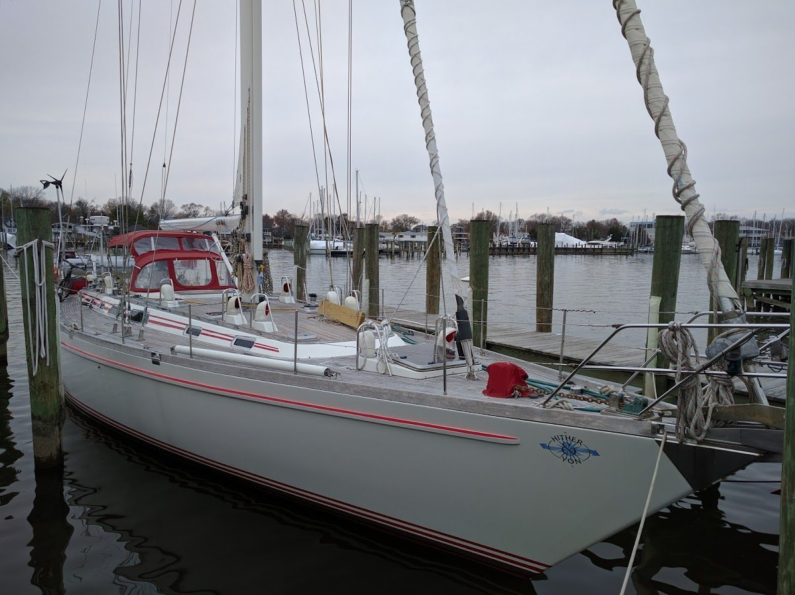

# Module 4 – Liquid Measurement & Sensor Selection

[← Back to Module 3](./03-sensor-characterization-and-calibration.md) | [Back to front page](../README.md) | [Quick module index](./00-index.md) | [Next: Module 5 →](./05-leds-and-light-output.md)

> A tank is not a number. Choose binary, thresholded, or continuous sensing for Nordwind's four tanks, and defend one choice per tank with evidence.

**Course placement:** Day 4 — the liquid-measurement studio. Two sessions; the Day 4 feedback conversation runs at the bench, with the rules and scheduling in the syllabus.

During the class, the instructors will also come around and check your existing portfolios.

## 🎯 Learning Goals

This module gives you the opportunity to explore liquid-level sensing and achieve competency in sensor selection, tank calibration, and the safety and maintenance constraints of real liquids.

By the end of this module, you can:
1. Explain the difference between **binary, thresholded, continuous, and hybrid** sensing, and what each candidate principle actually measures.
2. Match a principle to a tank, liquid, decision, and failure mode using opacity, foam, conductivity, dielectric constant, density, hygiene, flammability, tank shape, mounting, and motion.
3. Build and calibrate **one continuous and one binary** mock-tank measurement, and combine them into a hybrid where useful; convert continuous readings into level and volume and state the uncertainty.
4. Use a motion/shock sensor to distinguish “in harbor” from “outside” and explain how boat motion affects the tank reading.
5. Write a pod recommendation and a short theory report, and transfer the reasoning to a local industrial story.

**⬇︎ ===== DRAFT BOUNDARY — content below is a provisional draft ===== ⬇︎**

## 📖 Story — The Charter Boat That Did Not Know How Full It Was

**Nordsee Charter Cuxhaven GmbH** runs **SY "Nordwind"**, a 14 m sailing yacht, from **Cuxhaven**: day trips to **Helgoland**, multi-day trips along the **East Frisian coast**, and occasional **Atlantic delivery** trips. Owner and skipper **Hauke Petersen**; marine systems engineer **Imke Thomsen**.

On a late-October return from Helgoland, the fuel gauge on *Nordwind* stuck at a quarter tank. The engine died on the approach to **Neuwerk**; Hauke had to sail the last miles into the **Alte Liebe** harbor with the tide falling and a charter group on board. The same week, the holding-tank alarm only sounded when the tank was already over the floorboards, and a guest ran the fresh-water tank dry because the gauge showed "half" until it showed "empty". The charter office wants a remote view of the fleet; Hauke wants a local display he can trust before the next booking.

*Nordwind* has four tanks: **diesel**, **fresh water**, **waste water (holding tank)**, and the **bilge**. The first three are volume problems; the bilge is a presence problem — any water there is a message. The boat rolls, pitches, and heels; the liquid surface is never flat, and the tanks are not simple boxes. The sensors must survive salt, vibration, condensation, and a wet deck. Hauke's question is not "which sensor is best?" but *"which principle fits this tank, this liquid, and this failure mode — and what will it cost in maintenance and false alarms?"*

### Where this challenge comes from

The first version of this challenge was built on a friend's yacht **Hither & Yon** on the US East Coast — the boat in the photo. He used the boat himself and chartered it out, and he needed a reliable way to see fuel, fresh water, and waste water at a glance, from the dock and later remotely. We developed the challenge together; he has since sold the boat, but the challenge remains.

We first taught it in the IoT class at the **University of Applied Sciences Linz, Campus Hagenberg**; it later moved with the course to **Tartu**. The North Sea charter above is the German adaptation. The tanks, liquids, and failure modes are the same — only the weather is worse.

*Photo from the original challenge; used with permission.*

## 🛠️ Studio — two principles, 4–5 rows

Work in your Task Pod. Pair with a neighbouring Task Pod: one shared `## Study log` per pair, shared data and picture proofs, but **one report per pod**. Between the two pods, aim for **4–5 decision-sheet rows** (the four tanks plus the optional fifth). Every student adds a short contribution note and links the pod report from their portfolio. Compare results; mark your most epic ideas and fails for the gallery walk.

### We need — look at home

We are all looking at home for these — instructors and students. Bring what you find; no need to buy anything. It is a small class, and we share what we have.

| We need | Notes |
|---|---|
| 2–3 clear plastic bottles or large plastic cups | Any size; lids if you have them |
| Water | Tap water is fine |
| Cooking oil (optional) | A small amount; any cooking oil |
| Trays, towels, ruler, funnel, labels | Look at home; bring what you find |
| Cardboard, scissors, glue, tape | Look at home; bring what you find |
| Salt, dish soap, coffee grounds/soil/paper | For the dirty-water and foam simulants |

**Sensor menu** ToF, ultrasonic, Hall + magnet float, foil/copper-tape capacitive, analog capacitive liquid/soil probe, light barrier (photo-interrupter), reed/float switch, MPR121 (optional), M5StickC-S3 IMU, HX711 scale (shared). Across the class, aim for roughly 80% coverage of the menu. With your neighbouring pod, fill **4–5 decision-sheet rows**.

Some things are shared — the three HX711 scales, the multimeters, and the ToF/ultrasonic modules if the kit is short. It is a small class; we will sort it out in the room.

> [!WARNING]
> **Water, oil, and electronics.** No real fuel and no real waste water; no tasting ;-). No hot liquids and no open flame. Keep the ESP32, the scale, and the breadboard dry; use trays and towels; clean up spills; dispose of oil separately, not in the sink. Cooking oil is a qualitative fuel simulant, not diesel.
>
> **Ultrasonic warning.** Some ultrasonic modules are 5 V devices — check before connecting to 3.3 V logic, and use a level shifter/voltage divider for the echo line. Talk to the instructor(s) if you are unsure.

### The decision sheet

| Tank | Decision | Mode | Principle (primary / failsafe / backup) | Evidence | Failure + installation note |
|---|---|---|---|---|---|
| Diesel | range / low alarm | continuous + low failsafe | | | |
| Fresh water | fill level / low alarm | continuous + low failsafe | | | |
| Waste water | full alarm | threshold + high failsafe | | | |
| Bilge | presence alarm | binary / staggered | | | |

**Mode** is the key design choice: **binary** (yes/no), **threshold** (a limit with hysteresis), **continuous** (level/volume), or a **hybrid**. A good hybrid is a continuous reading plus a binary failsafe at the critical limit, or several binary switches at different heights (staggered binary — for example, several capacitive levels). The rows above are examples, not prescriptions. With your neighbouring pod, aim to fill **4–5 rows**; if something is hard, share wider in class.

> The original challenge also listed heating/AC water. On *Nordwind* that is the engine coolant/heating loop; add it as an optional fifth row if you want the extra case.

### Explore — test principles, fill 4–5 rows

Every sensor mode is binary, thresholded, continuous, or a hybrid. The tank decision decides which you need. The full principle reference is in the [resource bank](./Z-resources-bank.md#liquid-level-principles); use it when you need it, not as a lecture.

For each row, you study:

1. **Pick your tanks and liquid.** Between the two pods, split the four tanks (plus the optional fifth). Build a clear plastic mock tank for the first one; put it on the shared scale if you test weight.
2. **Test one continuous and one binary principle.** Continuous: ToF, ultrasonic, scale, analog capacitive probe. Binary: Hall float, reed/float, light barrier, capacitive threshold. Record what each measures, what it needs, and one failure. You can combine them later into a hybrid.
3. **Measure and calibrate.** For a continuous principle, log empty/half/full and convert to level/volume; for a binary principle, find the threshold and add hysteresis. Use the scale check if you test weight.
4. **Fill your rows.** Add your test cards and decision-sheet rows to the shared table. Between the two pods, aim for 4–5 rows; compare with the class.
5. **Label the sea state.** Mount the M5StickC-S3 on the mock boat/tray; log `in harbor` (still), `moving` (gentle rock), and `rough` (sharp shake). Note how the level reading changes. The BMI270 is a 6-axis IMU; acceleration magnitude + a short window is enough. Add notes in your rows on how the waves affect your reading.

### Break and choose

1. **Try the failure cases that matter.** Clear drinking water often defeats ToF; the ultrasonic sensor usually works, but a slender bottle can give echoes. Foam is worth trying — non-contact sensors may see the foam, while the scale does not. Also try tilt/slosh, empty/full, and condensation. Record what the failure looks like in the data.
2. **Make the choice robust.** Add a filter, hysteresis, or debounce; decide whether the tank needs binary, threshold, continuous, or a hybrid (continuous + failsafe, or staggered binary). Set a local alarm with a clear state.
3. **Complete 4–5 rows.** With your neighbouring pod, fill the shared decision sheet. Add a primary, a failsafe/backup principle, the evidence, and one installation note per row.
4. **Build one demo and take picture proofs.** Use the M5StickC-S3 screen, an OLED, LEDs/buzzer, the serial plotter, or a collage of plots — whatever makes the tanks legible. Photograph the build, wiring, display, calibration, and one failure case; caption what each picture proves.

## ★ Task 2 — Transfer to a local industrial story

Pick a fictional local facility that measures liquids — a dairy, a brewery, a camper van, a fuel depot, a heating/AC loop, a wastewater plant, an aquarium. Do not reuse the boat.

- Who is the user, what liquid, what decision, and what failure hurts?
- Which principles from the decision sheet transfer, which do not, and why?
- Sketch the installation and the local display; say what you would verify before trusting it.
- Add it as a short paragraph in `Module04/README.md` as pod.

> **Speculate, then check.** The transfer story is allowed to be a hypothesis. Mark what you know from your bench, what you infer, and what you would measure next.

## ✅ What you hand in

1. **Decision sheet** — 4–5 rows filled with your neighbouring pod. Include mode, primary/failsafe/backup principle, evidence, failure + installation note.
2. **Test cards** — one per principle your pod tested: what it measures, works/fails, calibration/uncertainty.
3. **Demo and picture proofs** — one working mock tank, one visualization/alarm, photos with captions, and a code link.
4. **Pod reports** — one recommendation report and one short theory report per pod. The recommendation is the decision sheet plus a short paragraph per row; the theory report covers how your chosen principles work and how you calibrated and validated them. Every student adds a contribution note and links the pod report from their portfolio.
5. **Transfer paragraph** — one per pod, in `Module04/README.md`.

## Templates

### Scale check

Two readings define the line — 0 g (tare) and one known calibration mass; a third known mass (even your phone's published weight) is an optional check.

### Tank calibration record

| Added volume (mL) | Level from distance (mm) | Mass reading (g) | Calculated volume (mL) | Difference (mL) | Notes |
|---:|---:|---:|---:|---:|---|
| 0 | | | 0 | | empty |
| | | | | | |
| | | | | | |

### Test card

| Principle | Liquid | What it measures | Works? | Fails when? | Calibration/uncertainty |
|---|---|---|---|---|---|
| | | | | | |
| | | | | | |

## ◇ Optional extras

- **MPR121:** If you have an MPR121 capacitive-touch board and want the extra challenge, use it instead of the ESP32 touch pins; it is a clean I²C controller and a possible final-project part. See the [pre-study note](../pre-study.md#3-read-like-a-sensor-engineer).
- **Pump current:** If a Hall current sensor and a small pump are available, measure the current dry, wet, and blocked. No pump? Read and think about it, and add a sentence to the report.
- **Remote outlook / Node-RED:** Not required in this module. Describe what you would publish; build it in Module 8 or the final project.

## ✅ Suggested portfolio evidence (proofs of the learning goals)

1. Your two-pod decision-sheet rows and test cards.
2. Demo photos with captions.
3. Pod report plus your contribution note.
4. Transfer paragraph.

*You may prove the same goals another way. The reports are per pod; cite the shared log and the class table instead of copying them.*

## 📚 Reference & prompts

- [Liquid-level principles](./Z-resources-bank.md#liquid-level-principles) — what each sensor measures, output, strengths, and failure modes.
- [Formulas](./Z-resources-bank.md#formulas-you-will-use) — ToF, ultrasonic, level, volume, mass, scale.
- [Datasheets](./Z-resources-bank.md#datasheets--standards-to-read-once) — the sensor shelf.
- [Module 3](./03-sensor-characterization-and-calibration.md) — calibration record, uncertainty, filtering.

**Questions to ask an LLM (then verify against your bench):**

- "Compare ToF, ultrasonic, and weight for a diesel tank on a moving boat. Which one fails first, and why?"
- "How do I calibrate an HX711 scale with known masses, and what does tare do to the offset?"
- "My ToF works on a wall but not on clear water. My ultrasonic works on clear water but echoes in a slender bottle. Explain both and design a test."
- "How can an IMU distinguish a boat in harbor from a boat underway without sensor fusion?"
- "Which dielectric property makes capacitive water detection work through a plastic wall?"

> Treat each answer as a claim to test. Record where the model is wrong, vague, or over-confident.

---

[← Previous: Module 3](./03-sensor-characterization-and-calibration.md) | [Back to front page](../README.md) | [Quick module index](./00-index.md) | [Next: Module 5 — LEDs & Light as Output →](./05-leds-and-light-output.md)
